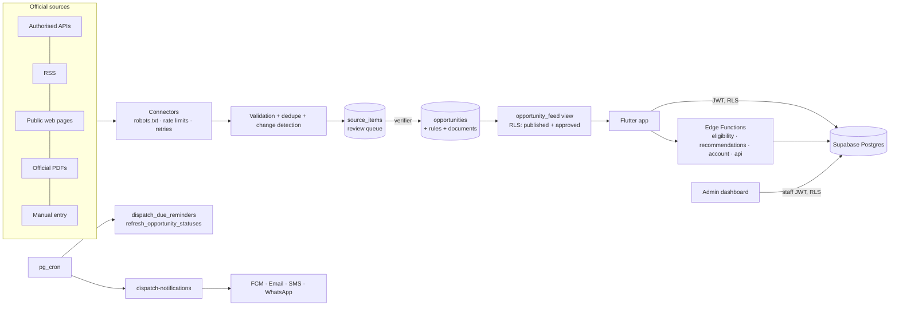

# Architecture

## Layers
- **app/** — `core/` (config, theme, l10n, router, settings, utils) · `data/` (models, repositories, offline cache, push) ·
  `widgets/` (design system: glass cards, tilt cards, animated gradients, 3D orb painter, progress ring, skeletons) ·
  `features/*` (one folder per area). State: Riverpod; navigation: go_router with a 5-tab `StatefulShellRoute`.
- **supabase/migrations/** — enums → profiles → opportunities → user activity → trust/community → functions & triggers →
  RLS → storage & cron → review workflow → feedback.
- **supabase/functions/_shared/** — pure TypeScript engines (eligibility, recommend, dedupe, validate, linkSafety,
  textExtract, robots), connectors, sync orchestrator, notification channels, REST client, API router. Pure modules are
  tested in Node; `index.ts` files are thin Deno handlers.
- **admin/** — dependency-free TypeScript SPA compiled with `tsc` to ES modules.

## Why these choices
- **Eligibility in TypeScript, not SQL**: deterministic, unit-testable, explainable output; results cached in
  `eligibility_checks` and invalidated by triggers when profiles or rules change.
- **Reminders in SQL**: scheduling, rescheduling on deadline changes, closure cancellation and de-duplication happen in
  triggers and unique indexes, so they are correct no matter which client changed the data.
- **Admin as a TypeScript web app instead of Flutter Web**: decoupled from mobile releases, tiny, CSP-friendly, and
  verifiable without the Flutter SDK (type-checked and browser-tested in CI).
- **Hand-rolled localisation**: avoids `gen-l10n` behaviour differences between Flutter versions; adding a language is
  adding one map (Punjabi, Sindhi, Pashto, Balochi can be added the same way).
